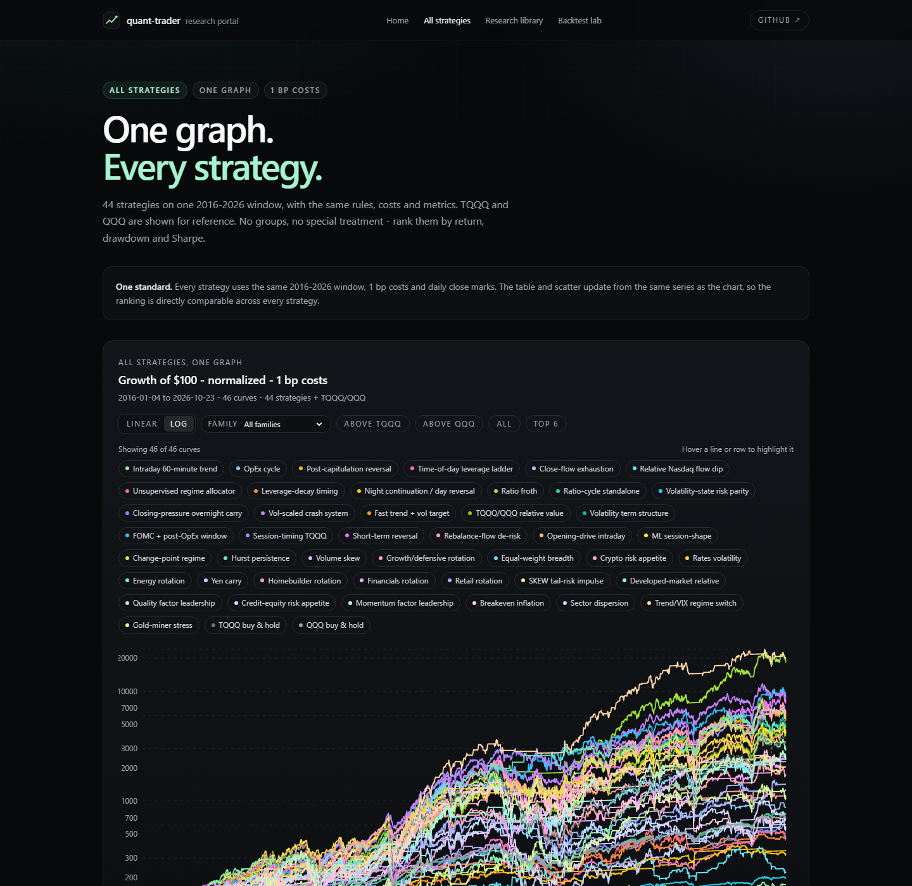
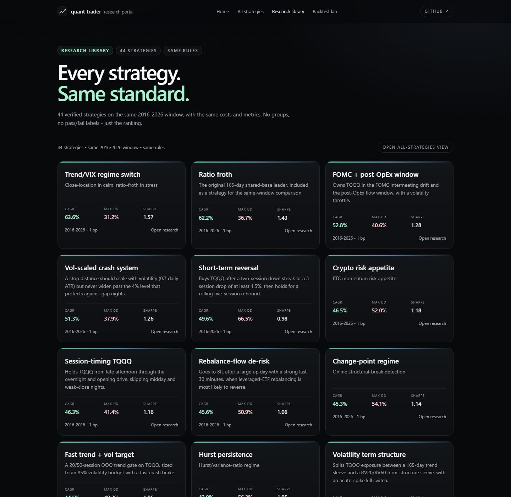
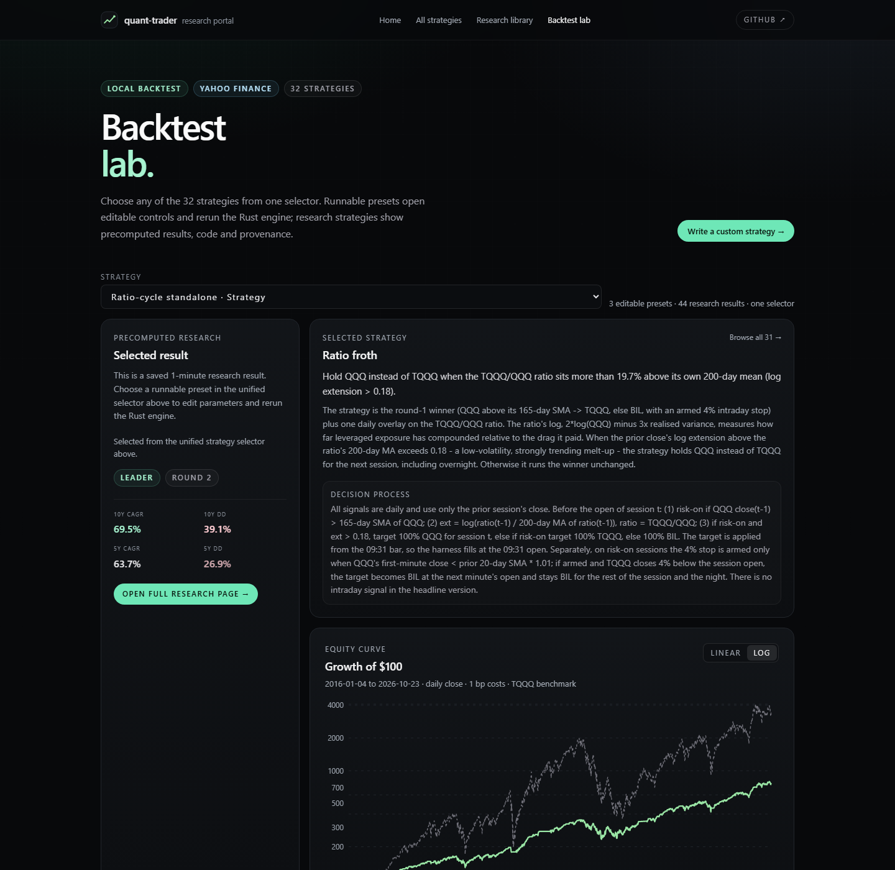

# quant-trader

A quantitative research library and paper-trading system for leveraged Nasdaq
exposure. The tradable universe is **QQQ**, **TQQQ** (3x daily Nasdaq-100), and
**BIL** (T-bills); no real-money orders are ever placed.

The repository has two layers:

- **Paper-trading engine** — Rust execution/backtest engine, TOML configs, and
  a Next.js dashboard.
- **Research library** — Python research on 1-minute QQQ/TQQQ/BIL data,
  cross-asset daily signals, frozen development windows, one-shot holdouts,
  and overlap audits.

## Current status

| Item | Value |
|---|---:|
| Visible strategies | **44** |
| Curves on the compare page | **46** |
| Above-TQQQ winners | **14** |
| New independent families | **20** |
| Max new-family Jaccard vs existing winners | **0.66** |
| Max new-family raw correlation | **0.693** |

### Headline results (full 2016-01-04 .. 2026-10-23, daily close, 1 bp)

| Strategy | CAGR | Max DD | Sharpe |
|---|---:|---:|---:|
| `family-regime-switch` (composite overlay) | **63.59%** | **31.40%** | **1.58** |
| `ratio-froth` (original trend/vol winner) | 62.21% | 36.65% | 1.43 |
| `fomc-opex-window` | 52.77% | 40.64% | 1.28 |
| `vol-scaled-crash-stop` | 51.32% | 37.88% | 1.26 |
| `family-short-reversal` | 49.54% | 66.46% | 0.98 |
| `family-crypto-risk-appetite` | 46.50% | 52.33% | 1.19 |
| `family-change-point` | 45.29% | 54.10% | 1.13 |
| `family-hurst-persistence` | 43.00% | 56.25% | 1.04 |
| `family-rates-volatility` | 38.80% | 43.01% | 1.05 |

`family-regime-switch` uses `family-close-location` when QQQ is above its
150-session moving average and VIX ≤25, and `ratio-froth` otherwise. It beats
`ratio-froth` on CAGR, drawdown, Sharpe and CAGR/DD, and at 5 bp and 10 bp:

| Cost | regime switch | ratio-froth |
|---:|---:|---:|
| 1 bp | **63.59%** | 62.21% |
| 5 bp | **59.19%** | 56.62% |
| 10 bp | **53.87%** | 50.67% |

The 2024-2026 holdout is **38.70% CAGR / 25.38% DD / 1.13 Sharpe**. The overlay
is a disclosed composite, not one of the 20 independent families. The raw-CAGR
component, `family-close-location`, returns 66.23% but with a 62.76% drawdown;
it is retained as the overlay's aggressive sleeve.

## The 20 new families

The new-family programme added 20 independent strategies with primary signals
outside the original library: volume asymmetry, change-point detection, Hurst
persistence, realized skew, sector rotation, breadth, crypto risk appetite,
rates volatility, energy rotation, yen carry, homebuilder/financials/retail
rotation, CBOE SKEW, EFA/SPY, QUAL/SPY, HYG/SPY, MTUM/SPY, breakeven inflation,
sector dispersion, and gold-miner stress.

Every addition has:

- a full 2024-2026 holdout;
- a `verified-full` record;
- signal Jaccard ≤0.66 and raw correlation ≤0.693 against the nine original
  winners.

See `research/new/NEW_FAMILIES.md`, `research/new/FAMILY_OVERLAP_AUDIT.md`, and
`research/new/OBJECTIVE_FEASIBILITY.md` for the ledger and audit.

## Repository layout

```
src/                 Rust paper-trading engine and backtester
web/                 Next.js dashboard (compare, research, lab)
research/            Python research and verification
research/new/        20-family programme, holdouts, overlap audit
research/revisit/    original winner curves and final checks
data/external/       committed Yahoo daily cross-asset series
configs/             TOML strategy/config files
scripts/             data export and intraday backtest helpers
docs/                notes and methodology
```

## Quick start

### Rust engine

```bash
cargo build --release
cargo test
cargo run -- --help
```

### Website

```bash
cd web
npm install
npm run dev      # http://localhost:3000
```

Production build:

```bash
cd web
npm run build
npm run start
```

### Research checks

```bash
pip install pandas numpy pyarrow
python research/revisit/final_check.py
python research/new/check_all_holdouts.py
python research/new/family_overlap_audit.py
```

`check_all_holdouts.py` verifies that every holdout partitions cleanly and
matches its published curve. `family_overlap_audit.py` reruns the 20×9
correlation/Jaccard/alpha audit.

## Website

The dashboard is a dark research portal with a mint accent, built with Next.js
and Recharts. It has four main views:

| View | Route | What it shows |
|---|---|---|
| **Home** | `/` | Hero, library counts, runnable presets, and research cards |
| **All strategies** | `/compare` | One normalized growth chart, log/linear toggle, family filter, above-TQQQ/above-QQQ filters |
| **Research library** | `/research` | Every verified strategy as a card with CAGR, max drawdown and Sharpe |
| **Backtest lab** | `/lab` | Strategy selector, editable presets, decision process, equity curve, custom-strategy entry |

Each research card opens a detail page at `/research/<slug>` with metrics, the
equity curve, the decision process, the audit assessment, and the code.

### Screenshots

**Home — one catalog for runnable presets and research**


**All strategies — one graph, 46 curves, 44 strategies**



**Research library — every strategy, same standard**



**Regime-switch detail — the beater's research page**


**Backtest lab — select, inspect and rerun**



### Run the website

```bash
cd web
npm install
npm run dev
# open http://localhost:3000
```

Production build:

```bash
cd web
npm run build
npm run start
# http://localhost:3000
```

The site reads precomputed JSON from `web/public/data/`. If you change the
research library, regenerate it with:

```bash
python research/export_compare_full.py
python research/export_research_rebuild.py
python research/export_web_catalog.py
python research/export_research_detail.py
```

The home page shows 47 cards: 3 editable Rust presets plus 44 research
strategies. The compare page shows 46 curves: the 44 strategies plus TQQQ and
QQQ benchmarks.

## Data

- The 1-minute QQQ/TQQQ/BIL panel lives under `data/` and is **not committed**
  (the directory is gitignored to keep the repository small).
- Daily Yahoo cross-asset series used by the external families are committed
  under `data/external/`. Provenance is in `data/external/SOURCE.md`; the fetch
  script is `research/fetch_external.py`.
- Signals use daily closes through the prior session and fill at the next QQQ
  open. The research harness enforces the 2% rebalance band and 1 bp headline
  cost, with 5/10 bp stress tables.

## Methodology

- **Frozen development window:** 2016-01-04 .. 2023-12-29.
- **One-shot holdout:** 2024-01-02 .. 2026-10-23; parameters are not tuned on it.
- **Long-only:** weights are non-negative and sum to ≤1; no synthetic shorts.
- **Overlap test:** signal Jaccard plus residual alpha, not raw correlation
  alone. Raw correlation between two long-TQQQ strategies is dominated by
  common TQQQ beta.
- **Winner policy:** one verified above-TQQQ winner per family; ties break on
  Sharpe, then lower drawdown.

## Caveats

- This is research and paper trading, not investment advice.
- The regime-switch overlay's 150/25 cell was the development-grid maximum.
  The full and holdout results are the out-of-sample checks; both hold, but the
  selection bias is disclosed.
- Turnover is high (about 35,000x for the overlay); the 10 bp CAGR is 53.87%.
- Several new families are active but below the TQQQ bar (37.54% CAGR), and some
  have large drawdowns. They are research records, not recommendations.
- Past performance does not guarantee future results.
