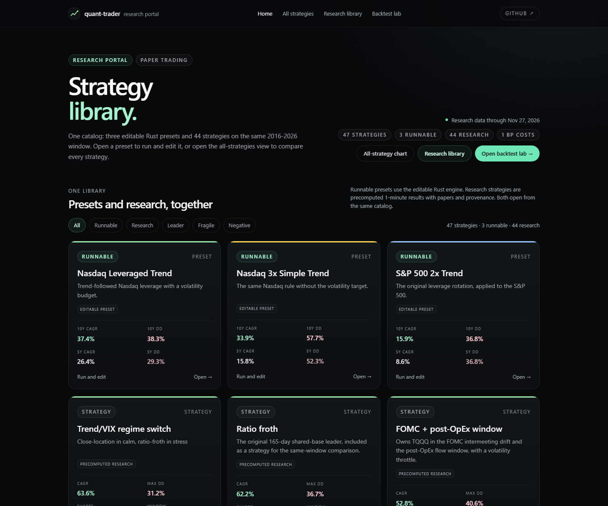
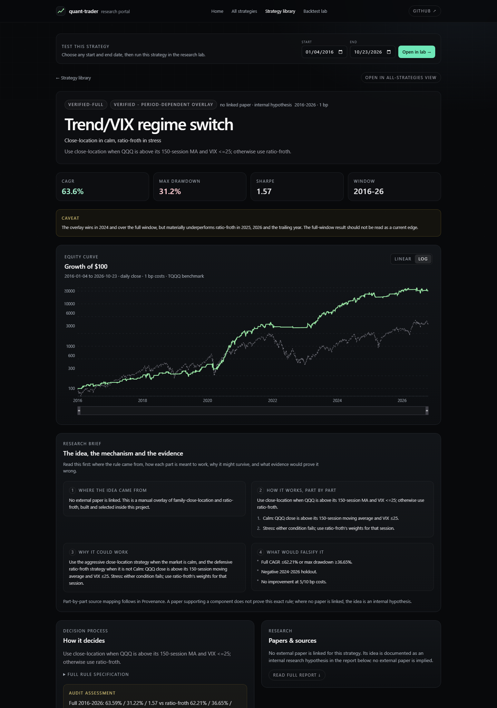

# quant-trader

A quantitative research library and paper-trading system for leveraged Nasdaq
exposure. The tradable universe is **QQQ**, **TQQQ** (3x daily Nasdaq-100), and
**BIL** (T-bills); no real-money orders are ever placed.

The repository has two layers:

- **Paper-trading engine** — Rust execution/backtest engine and TOML strategy
  configs.
- **Research library** — Python strategies, one-shot holdouts, and the Next.js
  research portal.

## Current status

| Item | Value |
|---|---:|
| Visible research strategies | **46** |
| Curves on the compare page | **48** |
| Above-TQQQ winners | **14** |

### Full-window results (2016-01-04 .. 2026-10-23, daily close, 1 bp)

Full-window figures are not a current-edge ranking. The regime-switch overlay has
the highest full-window CAGR, but its edge is period-dependent; the table below
shows the recent windows where it lags `ratio-froth`.

| Strategy | CAGR | Max DD | Sharpe |
|---|---:|---:|---:|
| `ratio-froth` (original trend/vol winner) | 62.21% | 36.65% | 1.43 |
| `family-regime-switch` (composite overlay; period-dependent) | **63.59%** | **31.22%** | **1.57** |
| `fomc-opex-window` | 52.77% | 40.64% | 1.28 |
| `vol-scaled-crash-stop` | 51.32% | 37.88% | 1.26 |
| `family-short-reversal` | 49.65% | 66.46% | 0.98 |
| `family-crypto-risk-appetite` | 46.50% | 52.02% | 1.18 |
| `family-change-point` | 45.29% | 54.10% | 1.14 |
| `family-hurst-persistence` | 43.00% | 56.25% | 1.05 |
| `family-rates-volatility` | 38.80% | 41.94% | 1.06 |

`family-regime-switch` uses `family-close-location` when QQQ is above its
150-session moving average and VIX ≤25, and `ratio-froth` otherwise. It beats
`ratio-froth` on CAGR, drawdown, Sharpe and CAGR/DD, and at 5 bp and 10 bp:

| Cost | regime switch | ratio-froth |
|---:|---:|---:|
| 1 bp | **63.59%** | 62.21% |
| 5 bp | **59.19%** | 56.62% |
| 10 bp | **53.87%** | 50.67% |

The 2024-2026 holdout is **38.70% CAGR / 25.38% DD / 1.13 Sharpe**. The overlay
is a composite of two existing strategies. Its aggressive sleeve,
`family-close-location`, returns 66.23% but with a 62.76% drawdown.

**The full-window lead is not robust through time:**

| Window | regime switch | ratio-froth |
|---|---:|---:|
| 2024 | **108.71%** | 89.73% |
| 2025 | 20.49% | **83.35%** |
| 2026 YTD | 0.79% | **29.83%** |
| Trailing 1 year | 13.67% | **37.35%** |
| Trailing 6 months | **−12.98%** | 23.42% |
| 2024-2026 holdout | 38.70% | **65.40%** |

It should be treated as a research overlay, not a current live edge.

## Repository layout

```
src/                 Rust paper-trading engine and backtester
web/                 Next.js dashboard (compare, strategy library, lab)
research/            Python research and verification
research/strategies/    every strategy (one folder each), shared harness, curves, holdouts, audits;
                        a strategy the Rust bot can trade also has bot.toml there
research/archive/       historical experiments kept for provenance
data/external/       committed Yahoo daily cross-asset series
scripts/             data export and intraday backtest helpers
docs/                notes and methodology
```

## Quick start

### Rust engine

```bash
cargo build --release
cargo test
cargo run -- --help
```

### Website

```bash
cd web
npm install
npm run dev      # http://localhost:3000
```

Production build:

```bash
cd web
npm run build
npm run start
```

### Research checks

```bash
pip install pandas numpy pyarrow
python research/strategies/final_check.py
python research/strategies/check_all_holdouts.py
```

`check_all_holdouts.py` verifies that every holdout partitions cleanly and
matches its published curve.

## Website

The dashboard is a dark research portal with a mint accent, built with Next.js
and Recharts. It has four main views:

| View | Route | What it shows |
|---|---|---|
| **Home** | `/` | Hero, library counts, and strategy cards |
| **All strategies** | `/compare` | One normalized growth chart, manual start/end dates, log/linear toggle, family filter, above-TQQQ/above-QQQ filters |
| **Strategy library** | `/strategies` | Every research strategy as a card with CAGR, max drawdown and Sharpe, recomputed for a selectable start/end range |
| **Backtest lab** | `/lab` | Strategy selector, manual start/end dates, Python parameters, equity and drawdown charts |

Every research strategy has one page at `/strategies/<slug>` (old `/research/...` links redirect) with a research brief (where the idea came from, how each part works, why it might work, what would falsify it), part-by-part provenance, metrics, the equity curve, the decision process, the audit assessment, and the code. Strategies with a `bot.toml` are also traded by the paper-trading bot; their research page remains read-only.

### Screenshots

**Home — one catalog of strategies**



**All strategies — one graph, 48 curves, 46 strategies**


**Strategy library — every strategy, same standard**


**Regime-switch detail — the composite overlay, with its period-dependence caveat**



**Backtest lab — select, inspect and rerun**


### Run the website

```bash
cd web
npm install
npm run dev
# open http://localhost:3000
```

Production build:

```bash
cd web
npm run build
npm run start
# http://localhost:3000
```

The library and compare pages read precomputed JSON from `web/public/data/`;
the lab runs Python on demand. If you change the research library, regenerate
the precomputed data with:

```bash
python research/export_compare_full.py
python research/export_research_rebuild.py
python research/export_web_catalog.py
python research/export_research_detail.py
python research/export_param_schema.py
```

The home page shows 47 cards: 46 research strategies plus the S&P 500 bot preset.
The compare page shows 48 curves: 46 research strategies plus TQQQ and QQQ
benchmarks. The lab runs any research strategy over a custom start/end range.

## Data

- The 1-minute QQQ/TQQQ/BIL panel lives under `data/` and is **not committed**
  (the directory is gitignored to keep the repository small).
- Daily Yahoo cross-asset series used by the cross-asset strategies are committed
  under `data/external/`. Provenance is in `data/external/SOURCE.md`; the fetch
  script is `research/fetch_external.py`.
- Signals use daily closes through the prior session and fill at the next QQQ
  open. The research harness enforces the 2% rebalance band and 1 bp headline
  cost, with 5/10 bp stress tables.

## Methodology

- **Frozen development window:** 2016-01-04 .. 2023-12-29.
- **One-shot holdout:** 2024-01-02 .. 2026-10-23; parameters are not tuned on it.
- **Long-only:** weights are non-negative and sum to ≤1; no synthetic shorts.
- **Execution:** signals use data through the prior session; targets fill at the
  next QQQ open, with a 2% rebalance band and 1 bp headline cost.
- **Winner policy:** one verified above-TQQQ winner per strategy category; ties
  break on Sharpe, then lower drawdown.
- **Paper provenance:** only strategies with an extracted external paper show a
  paper link. Most strategies are internal hypotheses; pages without a link say
  so explicitly rather than implying external support.

## Caveats

- This is research and paper trading, not investment advice.
- The regime-switch overlay's 150/25 cell was the development-grid maximum.
  The full and holdout results are the out-of-sample checks; both hold, but the
  selection bias is disclosed.
- Turnover is high (about 35,000x for the overlay); the 10 bp CAGR is 53.87%.
- Several strategies are active but below the TQQQ bar (37.54% CAGR), and some
  have large drawdowns. They are research records, not recommendations.
- Past performance does not guarantee future results.
